# ZRemoteX

[中文](README.md) | **English**

The phone companion app for controlling ZCode on the desktop (a fork with extra development of ZRemote). Sign in with your ZCode account to manage your remote devices: parallel sessions for multiple devices, a session overview, automation tasks, activity benefits, quota & usage insights and a Git workspace overview — all in one place.

## Screenshots

Real-device UI (1080×2400, OLED pure black, Chinese), with device names, workspace names, session titles, account and plan names masked. Full gallery: [docs/screenshots/](docs/screenshots).

**Devices & Sign-in**

<p align="center">
  
  
  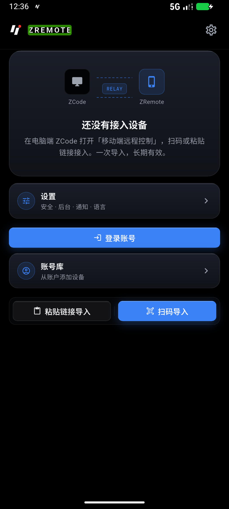
  
  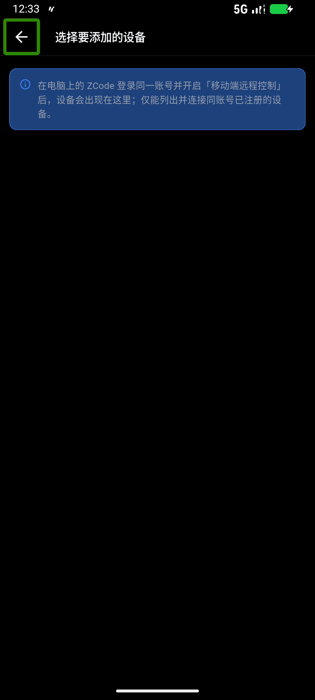
  
</p>

**Sessions & Control**

<p align="center">
  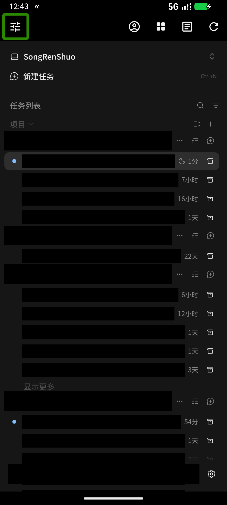
  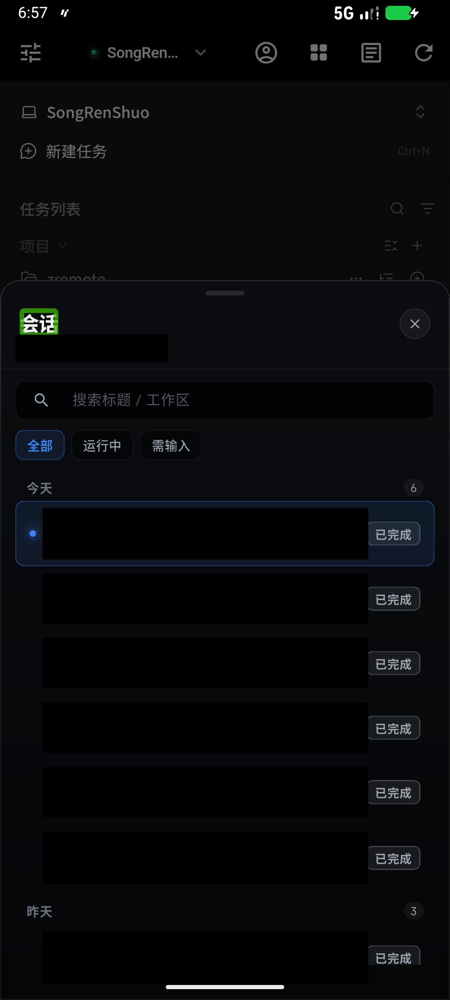
  
</p>

**Toolbox**

<p align="center">
  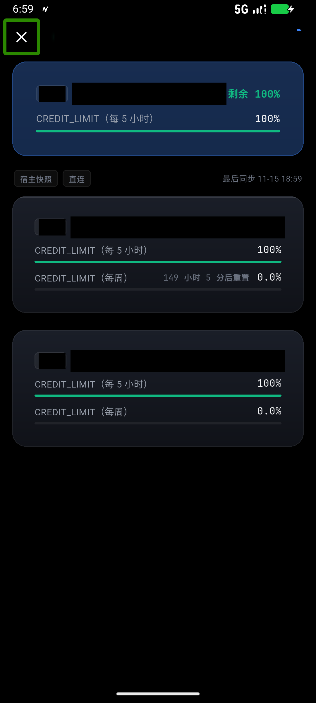
  
  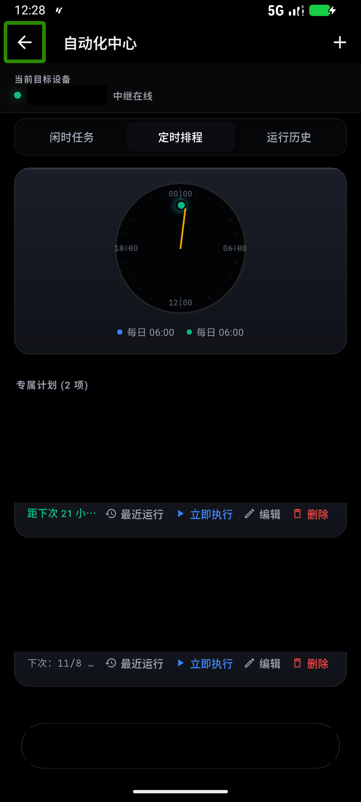
  
  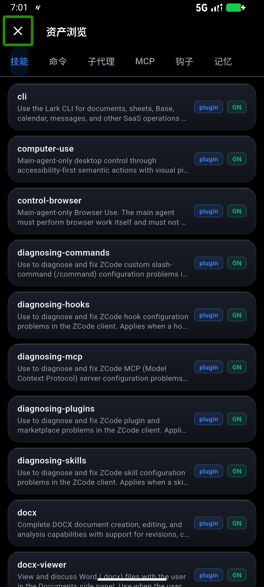
  
  
</p>

**Settings & Diagnostics**

<p align="center">
  
  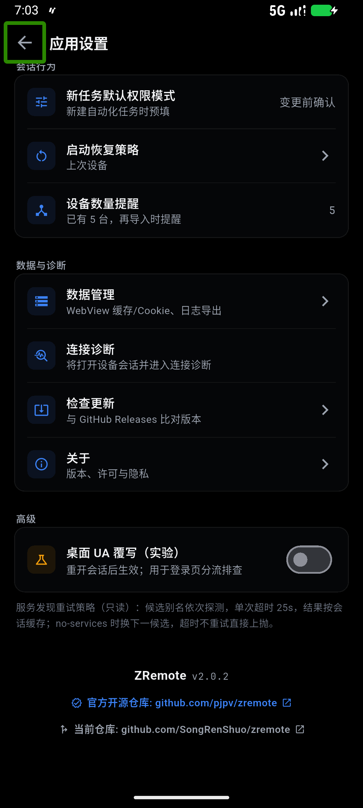
  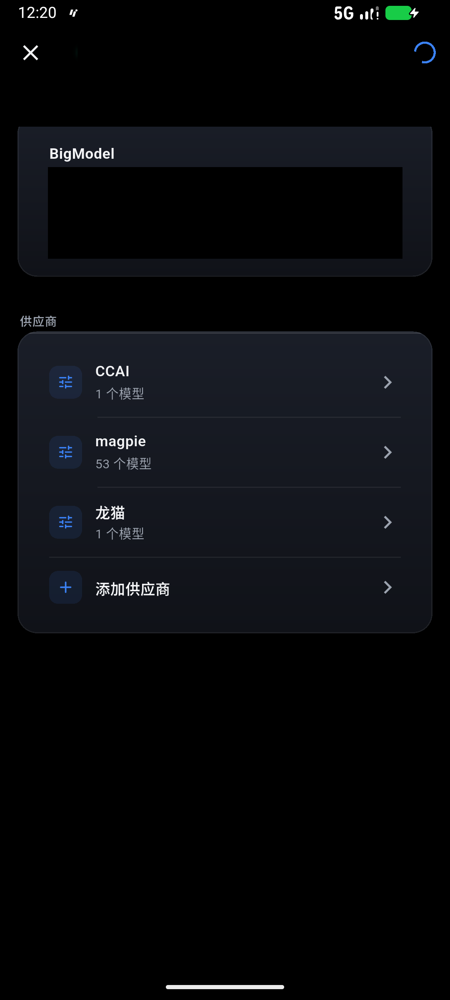
  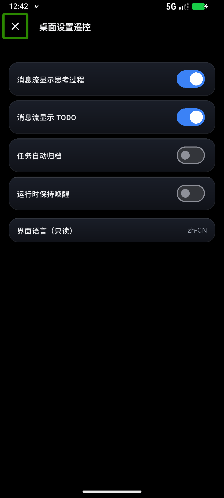
  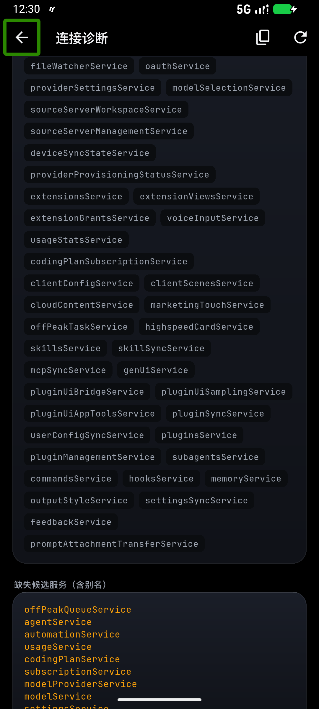
</p>

## Quick Start

1. Open "Remote Control" in ZCode on the desktop and show the QR code; **scan** it in the app, or **paste the link**
2. Or **sign in** with your ZCode account and add an already-registered device straight from your account (no scanning)
3. Tap a device card to open its control session; switch devices from the top bar and manage everything from the toolbox

## Features

**Devices & Sign-in**
- Import by QR scan / pasted link; **account-direct devices**: after signing in, list the remote devices registered to your account and add one with a tap (duplicate detection by SID / MID / name)
- Password sign-in (Z.ai CN / Z.ai Global / BigModel, embedded official login page)
- Account vault: save / switch / delete multiple accounts, apply one to a device, JWT expiry reminders; `.zsb` encrypted bundles compatible with the desktop zcode-switch
- Sign-in works even with zero devices: entries in the empty state, on the top-bar `+`, in the "add device" card and on the Settings page
- Adding a device from the account **picks up the login state automatically**: credentials are injected when the session opens, no manual "apply" in the vault needed

**Sessions & Control**
- Parallel sessions for all devices, switching without reconnecting; device switcher from the top bar
- Session overview panel: grouped by today / yesterday / earlier, status chips and relative time, search + status filters (all / running / needs input), live dot for the session being viewed, tap to jump
- Embedded remote page with theme following the app; health indicator (loading / live / error), manual reload + automatic reload fallback, auto-reconnect after returning from the background
- Background keep-alive: foreground service plus battery-optimization guidance

**Toolbox (one tap from the session top bar)**
- Automation tasks: create / edit / enable / delete off-peak and scheduled tasks, live status & queue, failure reasons, expandable run history, natural-language schedule ("Fridays 18:00")
- Benefits claiming: one-tap claim for limited-time plans; **auto-claim** (off by default; checks every 10 minutes, up to 5 per round, server-side cooldown, quiet hours, manual-priority yield) + claim history timeline + result notifications
- Quota center: grouped plans (tier badges, window bars, per-model balances, reset countdowns), reset cards with one-tap use, **quota usage alerts** (threshold 80% by default, adjustable, plus an exhausted state; notifications deep-link to quota / claim)
- Rewards center: the official rewards page embedded (login-state injection, external-link interception, theme following)
- Usage stats: summary, 30-day heatmap, daily model trend and share, per-day detail (all / 7d / 30d)
- Assets: read-only lists of Skills / Commands / Subagents / MCP / Hooks / Memory
- Model settings: provider & plan connections, model selection, key and connectivity tests
- Desktop settings remote: think/TODO in the message stream, task auto-archive, keep-awake and more (sensitive toggles confirmed one by one)
- Git overview: detail page with three sources (unstaged / staged / branch comparison), per-file `+added/-removed`, and a **full-screen unified diff** (line numbers, coloring, hunk folding)
- Connection diagnostics: service registry / method checks / endpoint probe report, copyable

**Notifications & Approvals**
- System notifications for approval requests, task completion and failure; per-type switches (approvals only by default), unread badges; notifications retract once handled on the desktop
- Native approval actions (Approve / Deny in the notification) and a "Stop" action on session cards

**Settings & Data**
- Appearance: language (Chinese / English / system), theme (light / dark / **OLED pure black**), font scale, motion, haptics
- Security: biometric gate (lock screen, auto-lock delay)
- Notifications: type switches + do-not-disturb window + per-device override
- Behavior: default permission mode for new tasks (Chinese labels), startup restore policy, device soft limit
- Data management: per-device WebView cache / cookie clearing, diagnostics log export (redacted), `.zsb` account bundle import/export
- About: version, official repo vs. current repo entries, update check with clear results

**Platform & Distribution**
- Android / iOS; deep links `https://zcode.z.ai/remote*` (App Links) and `zrsong://import`
- Android application id `cn.song.zremote`: installs **side by side** with the upstream signed package (account data is not shared; migrate with `.zsb`)
- Bilingual (Chinese / English)

## Project Repositories

- **Official open-source repository (upstream)**: [pjpv/zremote](https://github.com/pjpv/zremote) — this project is developed on top of it; thanks to the original author and upstream contributors
- **Current repository (this fork)**: [SongRenShuo/zremote](https://github.com/SongRenShuo/zremote) — releases and source of this build

## Download & Install

Get the latest build from the [Releases](https://github.com/SongRenShuo/zremote/releases) page:

- **Android** — `ZRemoteX-v<version>-android.apk`, install directly (application id `cn.song.zremote`, coexists with the upstream package)
- **iOS** — `ZRemoteX-v<version>-ios-unsigned.ipa`, an **unsigned build that cannot be installed directly**: sideload it with your own Apple ID via [AltStore](https://altstore.io), [Sideloadly](https://sideloadly.io), TrollStore, or similar (free-account signatures last 7 days and must be renewed)

## Building

Requirements:

- Flutter ≥ 3.38 (Dart ≥ 3.10)
- JDK 17 (Android builds)
- Xcode (iOS builds, macOS only)

```bash
flutter pub get

# Android
flutter build apk --release

# iOS (unsigned)
flutter build ios --release --no-codesign
```

## Disclaimer

ZRemoteX is a community-driven open-source project (a fork with extra development of ZRemote) and is not an official tool; it is not affiliated with Z.ai. ZCode and related names and trademarks belong to their respective owners.

This project is a **fork with additional development** of [pjpv/zremote](https://github.com/pjpv/zremote): the original upstream is maintained by its author and contributors, and this fork only adds features and fixes on top. **Upstream code and its attribution remain with the original author.** If something behaves differently from upstream, please report it upstream first.

## License

[MIT](LICENSE)
