# ZRemoteX

**中文** | [English](README.en.md)

ZCode 桌面端远程控制伴侣 App（ZRemote 的二次开发分支）。登录 ZCode 账号后管理你的远控设备：多设备并行会话、会话总览、自动化任务、活动权益领取、额度与用量查看、Git 工作区概览，全部收在一个界面里。

## 演示截图

真机界面（1080×2400，OLED 纯黑 · 中文），已对设备名 / 工作区名 / 任务标题 / 账号与套餐名等敏感信息打码。完整图库见 [docs/screenshots/](docs/screenshots)。

**设备与登录**

<p align="center">
  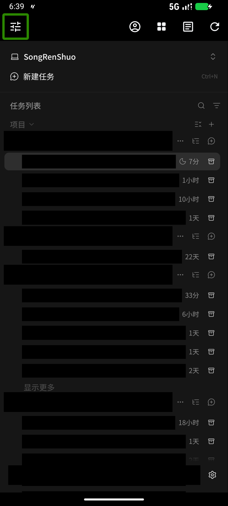
  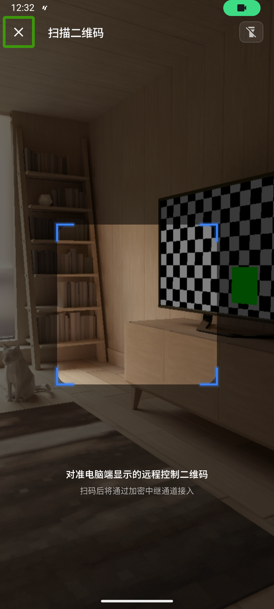
  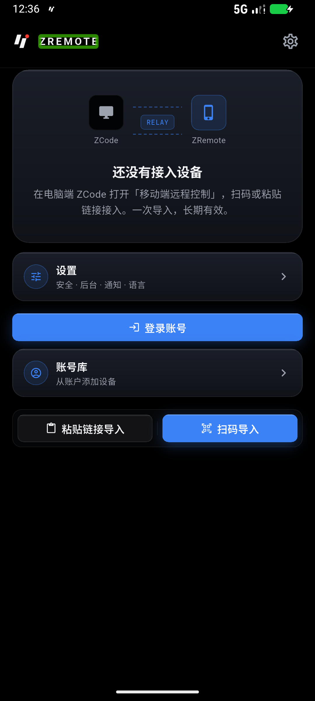
  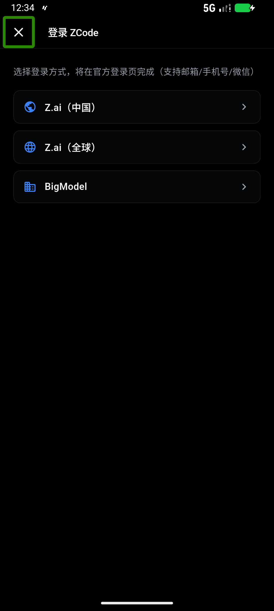
  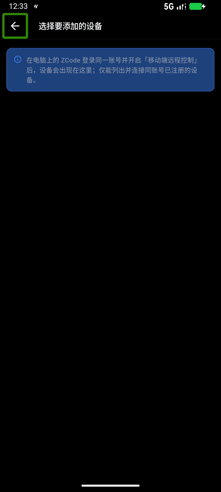
  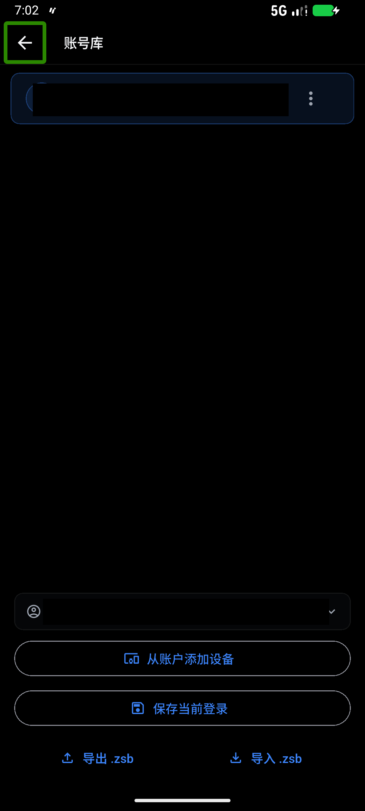
</p>

**会话与控制**

<p align="center">
  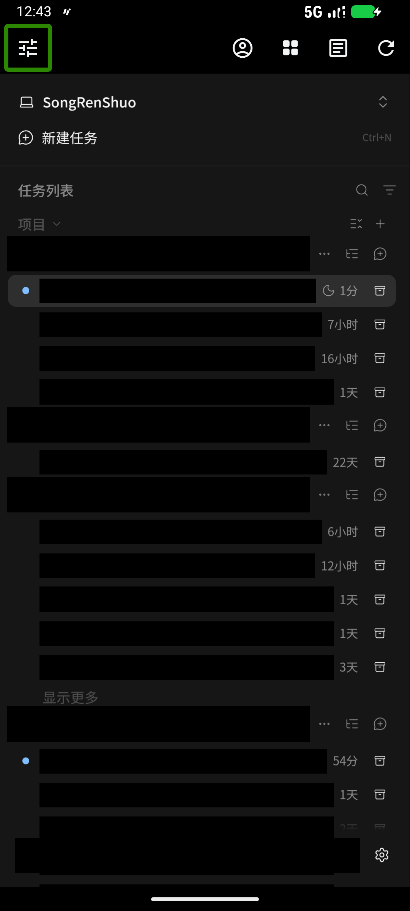
  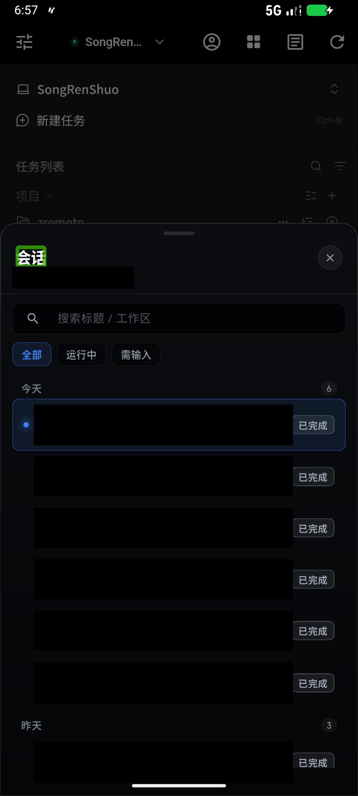
  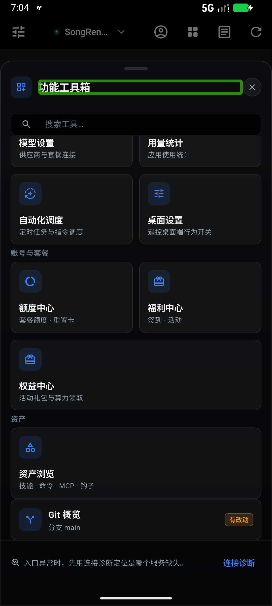
</p>

**工具箱**

<p align="center">
  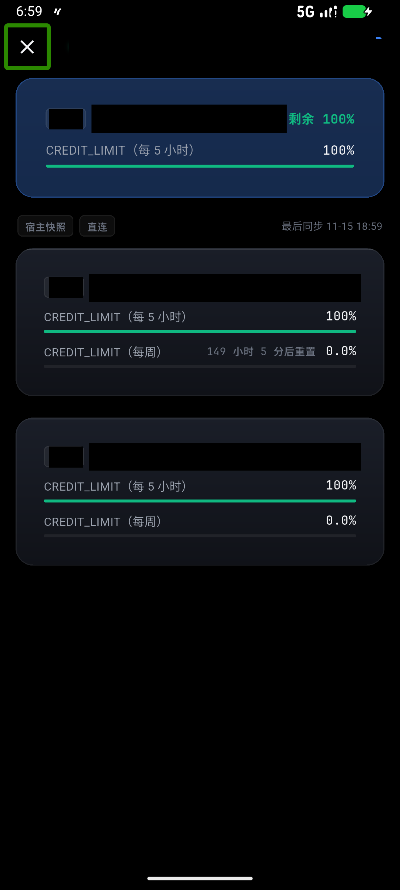
  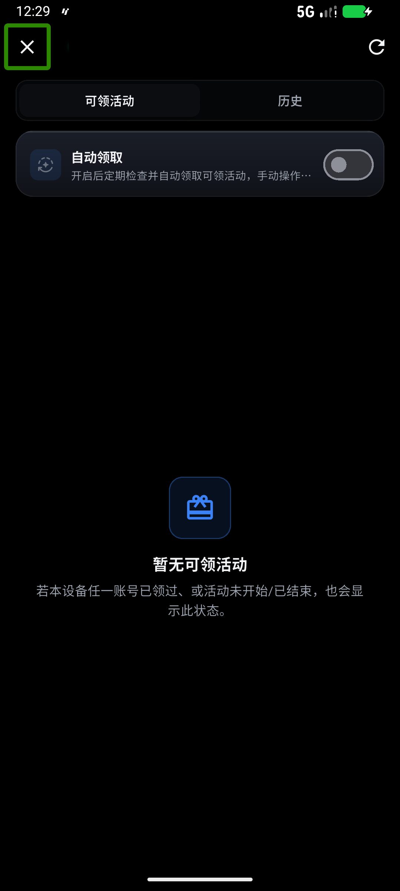
  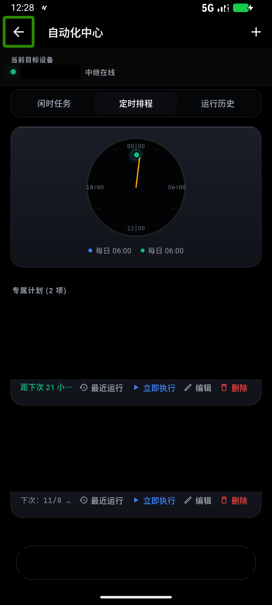
  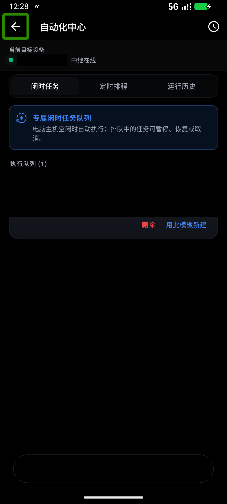
  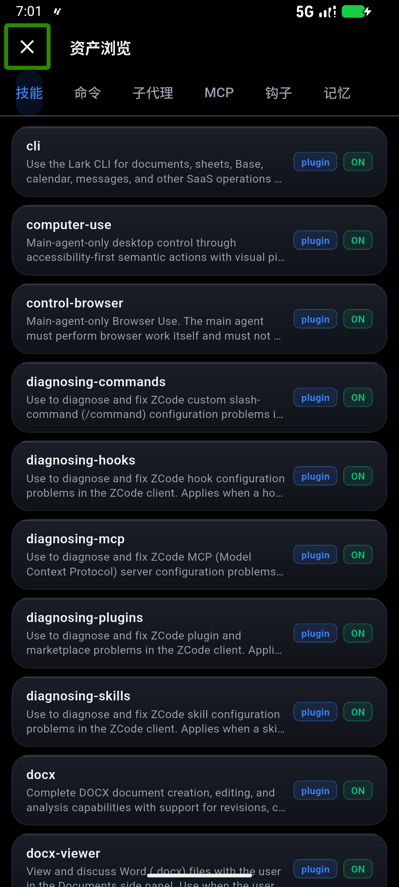
  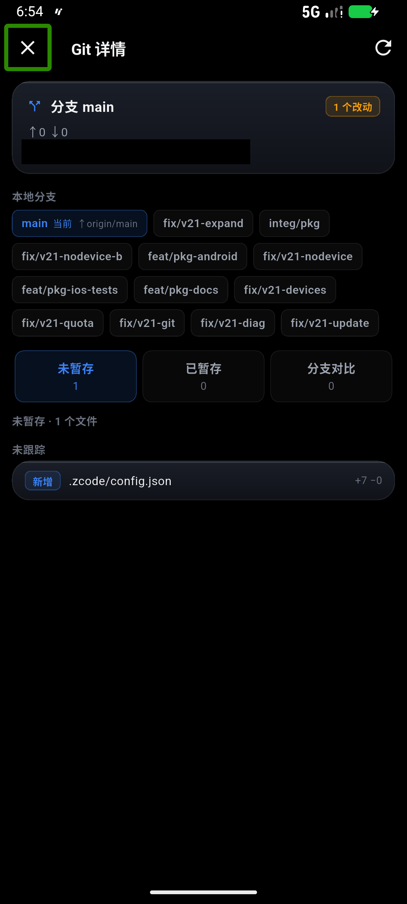
  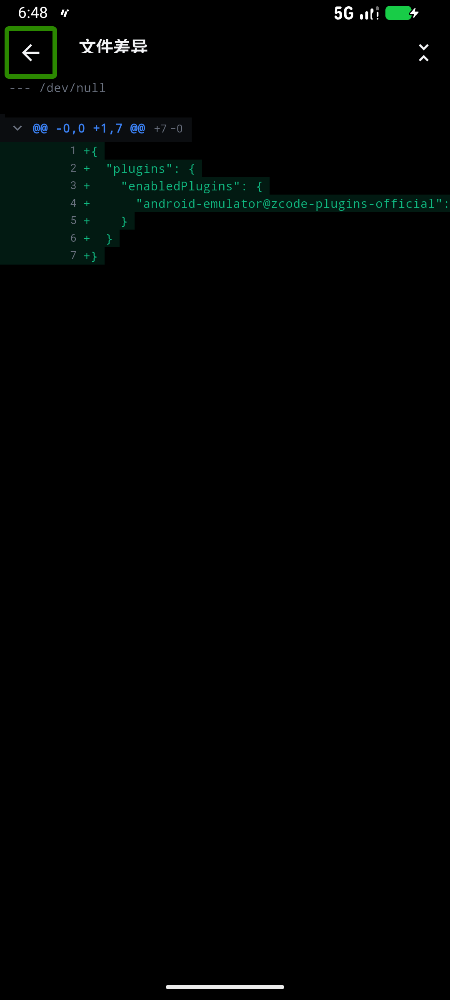
</p>

**设置与诊断**

<p align="center">
  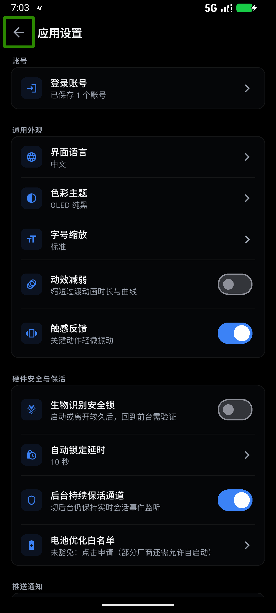
  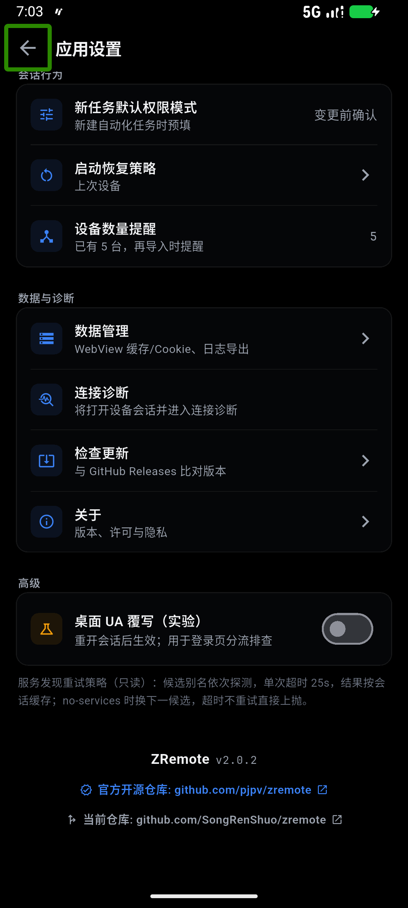
  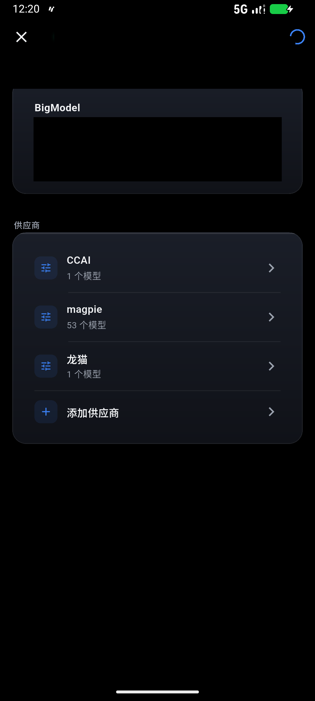
  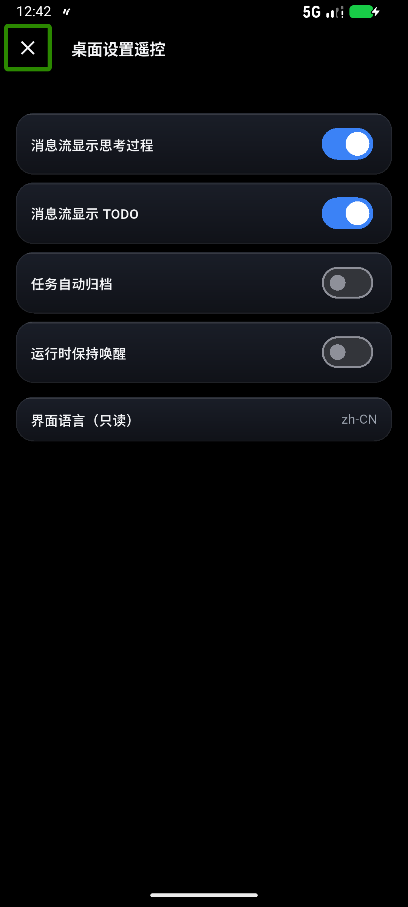
  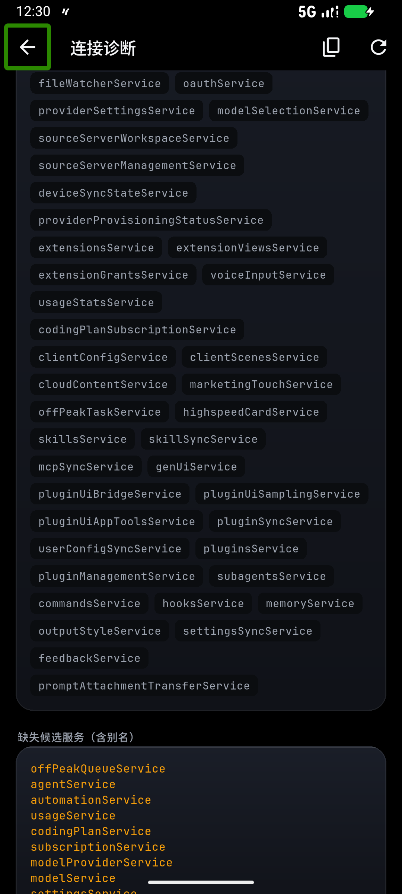
</p>

## 快速开始

1. 电脑端 ZCode 打开「远程控制」，出示二维码；手机 App **扫码**或**粘贴链接**导入设备
2. 也可以先**登录 ZCode 账号**，再从账号里**直接添加已注册的设备**（免扫码）
3. 点击设备卡片进入控制会话；顶栏随时切换设备，工具箱集中管理各项能力

## 功能

**设备与登录**
- 扫码 / 粘贴链接导入；**账户直连**：登录账号后列出本账号已注册的远控设备，选择即可添加（同 SID/同 MID/同名自动去重）
- 账密登录（Z.ai 中国 / Z.ai 全球 / BigModel 三选，内嵌官方登录页）
- 账号保险库：多账号保存 / 切换 / 删除、应用到设备、JWT 到期提醒；`.zsb` 加密包与桌面 zcode-switch 互导
- 0 设备也能登录：空设备态、顶栏 `+`、底部「接入新设备」与设置页均有登录入口
- 从账户添加设备后**登录态自动跟上**：进入会话自动注入凭据，无需再去账户库手动「应用」

**会话与控制**
- 多设备并行会话，切换不重连；顶栏标题随时切设备
- 会话总览面板：按今天 / 昨天 / 更早日历分组，状态胶囊与相对时间，搜索 + 状态过滤（全部 / 运行中 / 待输入），蓝点实时跟随正在查看的会话，点按跳转定位
- 远控页内嵌（ZCode 页面），深浅色与网页一并换肤
- 会话健康指示（加载中 / 已连接 / 异常）+ 一键刷新与自动重载兜底；长时间挂后台回前台自动重连
- 后台保活：前台守护服务 + 电池优化白名单引导

**工具箱（会话顶栏一键展开）**
- 自动化任务：闲时任务与定时计划创建 / 编辑 / 启停 / 删除，执行状态与排队实时上卡、失败原因可见、运行历史可展开，计划时间用「每周五 18:00」自然语言展示
- 活动权益领取：限时活动套餐一键领取；**自动领取**（开关默认关，每 10 分钟检查、单轮最多 5 个、服务端冷却精确读取、静默时段、手动优先让位）+ 领取历史时间线 + 结果通知
- 额度中心：多套餐分组（档位徽章 / 窗口条 / 各模型余额 / 重置倒计时）、重置卡状态与一键使用、**额度消耗预警**（阈值默认 80% 可调 + 耗尽档，通知可直达额度中心/领取页）
- 福利中心：官方 rewards 页内嵌（登录态注入、外链拦截、主题跟随）
- 用量统计：汇总读数、30 天热力图、每日模型趋势与占比，点按看当日明细（全部 / 近 7 天 / 近 30 天）
- 资产浏览：Skills / Commands / Subagents / MCP / Hooks / Memory 六类只读清单
- 模型设置：供应商与套餐连接、模型选择、密钥与连通性测试
- 桌面设置遥控：消息流显示思考 / TODO、任务自动归档、保活等桌面开关（敏感项逐项确认）
- Git 概览：详情页三来源（未暂存 / 已暂存 / 分支对比）带计数与 `+新增/-删除`，**全屏 unified diff**（行号、增删着色、按 hunk 折叠）
- 连接诊断：服务注册表 / 方法检查 / 端点探测报告，可复制导出

**通知与审批**
- 审批请求、任务完成 / 失败系统通知；类型可分开关（默认仅审批），未读徽标一目了然；桌面端处理待办后通知自动撤回
- 原生审批动作（通知上的「批准 / 拒绝」）+ 会话卡「停止」

**设置与数据**
- 外观：语言（中 / 英 / 跟随系统）、主题（浅色 / 深色 / **OLED 纯黑**）、字号、动效、触感
- 安全：生物识别门禁（锁屏、自动锁定延时）
- 通知：类型开关 + 免打扰时段 + 每设备覆盖
- 行为：新任务默认权限模式（中文四档）、启动恢复策略、设备数量软上限
- 数据管理：分设备清理 WebView 缓存 / Cookie、诊断日志导出（脱敏）、`.zsb` 账号包导入导出
- 关于：版本、官方仓库与当前仓库入口、检查更新（三态结果提示）

**平台与分发**
- Android / iOS；深链 `https://zcode.z.ai/remote*`（App Links）与 `zrsong://import`
- Android 包名 `cn.song.zremote`：可与上游 `pjpv/zremote` 正式签名包**同机共存**（账号数据不通用，可用 `.zsb` 迁移）
- 中英双语

## 项目地址

- **官方开源仓库（上游）**：[pjpv/zremote](https://github.com/pjpv/zremote) —— 本项目在其基础上二次开发，感谢原作者与上游贡献者
- **当前仓库（本分支）**：[SongRenShuo/zremote](https://github.com/SongRenShuo/zremote) —— 本版本的发布与源码

## 下载与安装

到 [Releases](https://github.com/SongRenShuo/zremote/releases) 页获取最新版：

- **Android** —— `ZRemoteX-v<版本>-android.apk`，下载后直接安装（包名 `cn.song.zremote`，与上游包共存）
- **iOS** —— `ZRemoteX-v<版本>-ios-unsigned.ipa`，**未签名包，无法直接安装**：请使用 [AltStore](https://altstore.io)、[Sideloadly](https://sideloadly.io) 或 TrollStore 等工具，用自己的 Apple ID 签名后侧载（免费账号签名有效期 7 天，到期需重新签名）

## 构建

环境要求：

- Flutter ≥ 3.38（Dart ≥ 3.10）
- JDK 17（Android 构建）
- Xcode（iOS 构建，需 macOS）

```bash
flutter pub get

# Android
flutter build apk --release

# iOS（未签名）
flutter build ios --release --no-codesign
```

## 声明

ZRemoteX 是社区开发的开源项目（ZRemote 的二次开发分支），非官方工具，与 Z.ai 无关联。ZCode 及相关名称与商标归其各自所有者。

本项目是 [pjpv/zremote](https://github.com/pjpv/zremote) 的**二次开发分支**：上游原版由其作者与贡献者维护，本分支在其基础上做功能增强与问题修复，**上游代码与署名权归原作者所有**；如与上游行为不一致，请先向上游反馈。

## License

[MIT](LICENSE)
